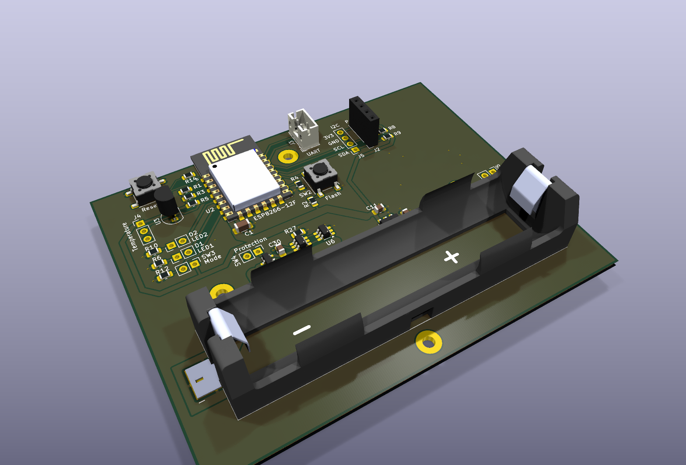
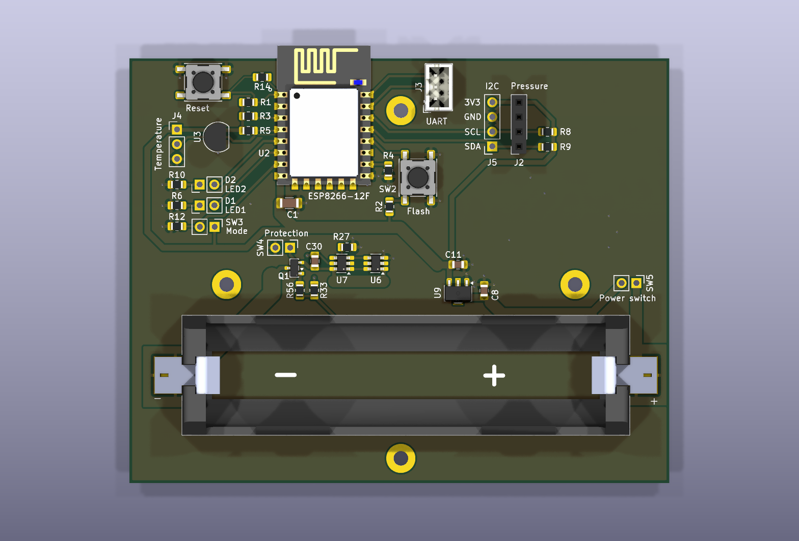
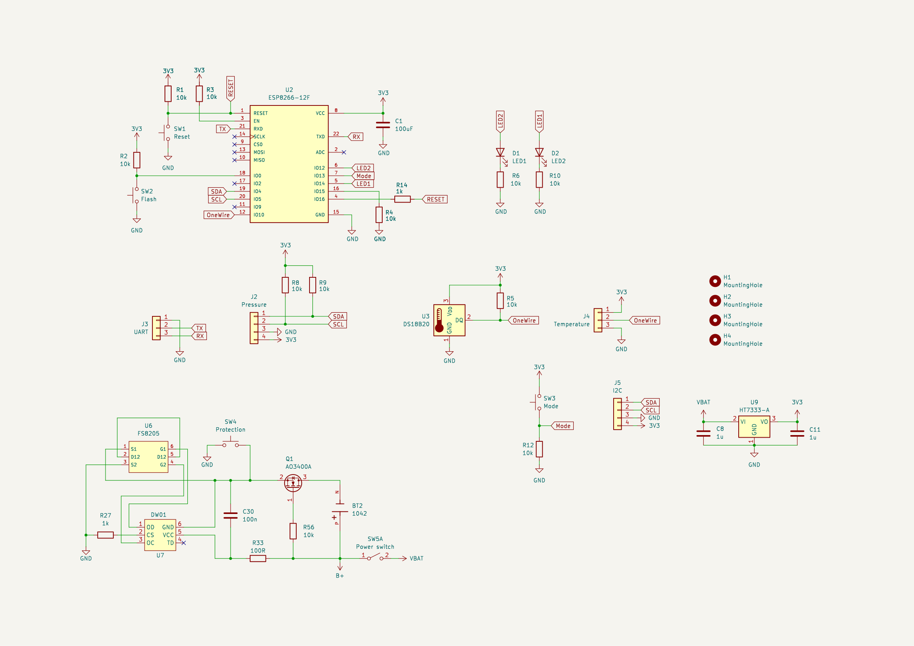
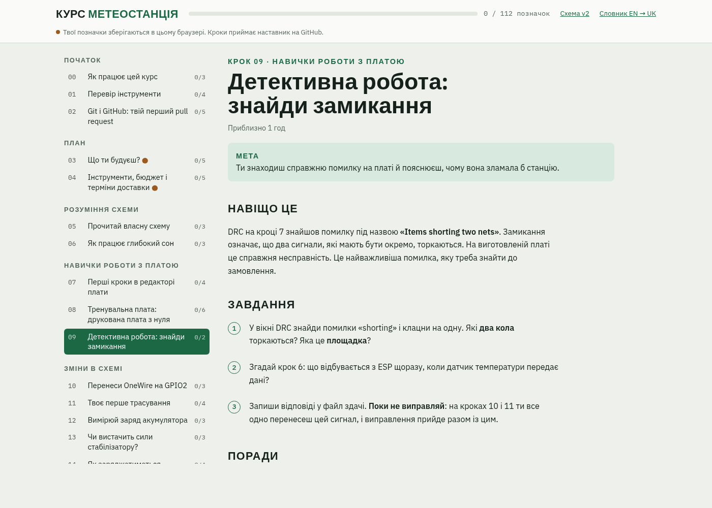
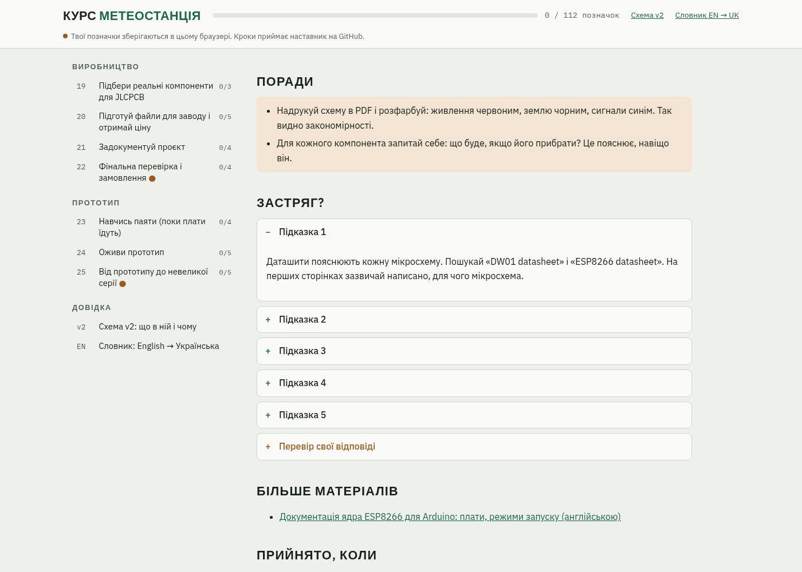
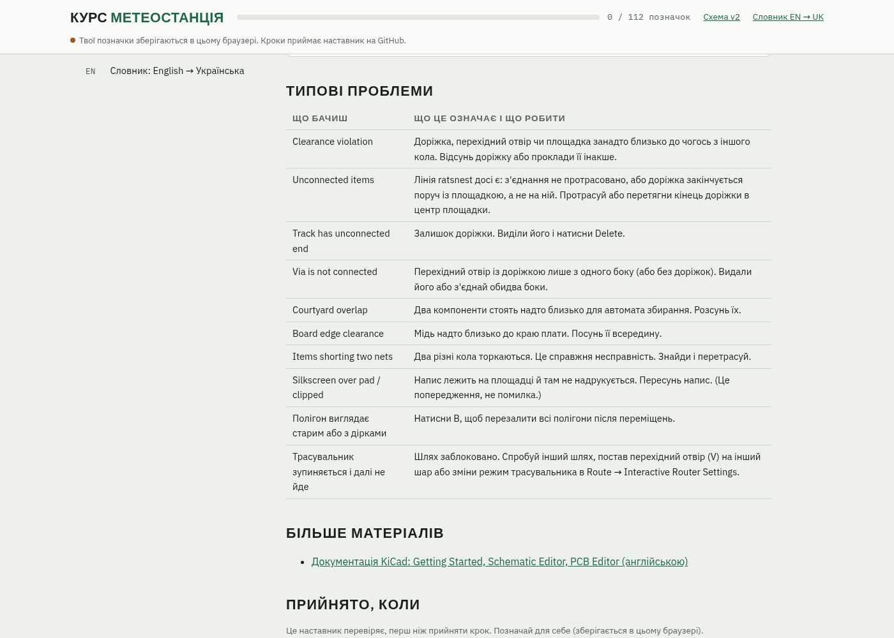
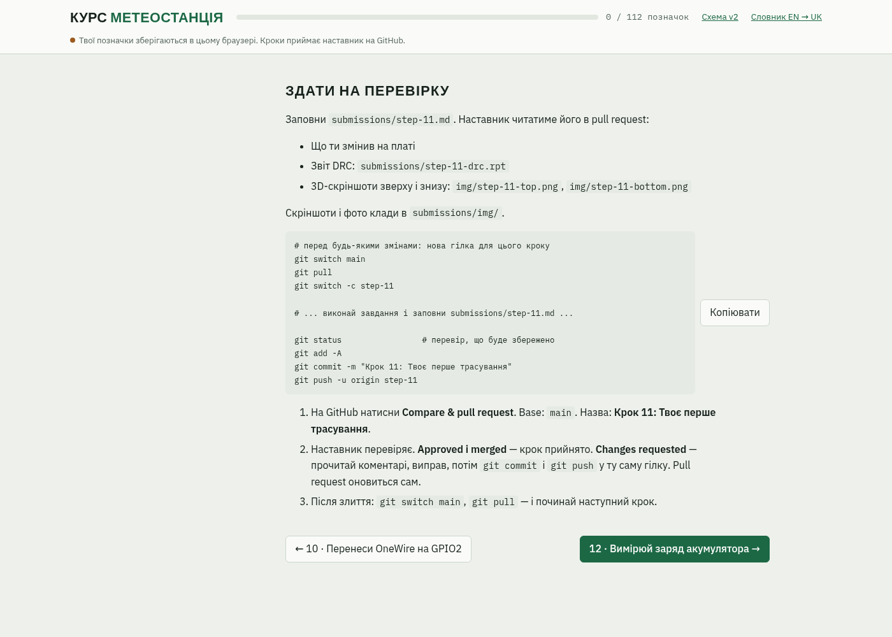
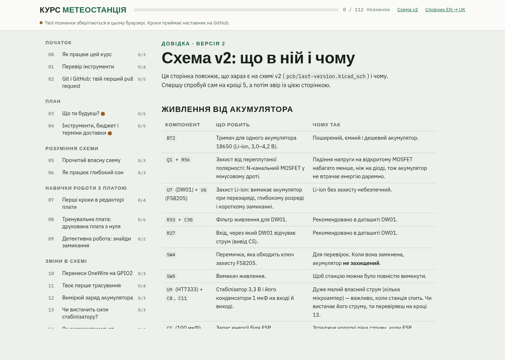
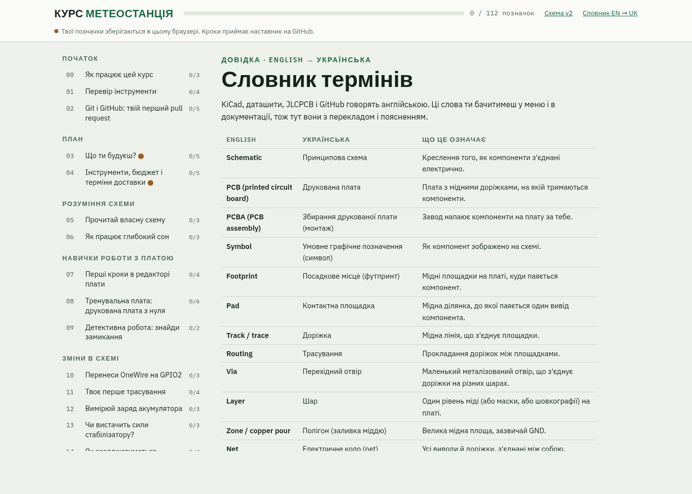

# Метеостанція на ESP8266

Невелика метеостанція з живленням від акумулятора: вона вимірює температуру і тиск повітря, надсилає дані на сервер і в Telegram, а між вимірюваннями спить, щоб акумулятор тримав якомога довше.



- **Мозок:** модуль ESP-12F (ESP8266) з Wi-Fi.
- **Датчики:** DS18B20 (температура) і BMP280 (тиск і температура).
- **Живлення:** акумулятор 18650 із захистом (DW01 + FS8205) і стабілізатором 3,3 В.
- **Сон:** ESP прокидається раз на 10 хвилин, вимірює, надсилає і знову засинає.

Мета — перетворити цей прототип на продукт: друковані плати, які виготовляє і збирає завод JLCPCB, корпус для вулиці, а потім невелика серія на продаж. Шлях до цього розписаний у курсі в цьому репозиторії.

## Як це виглядає зараз

Це поточна версія v2, ще до змін, які ти зробиш на курсі (наприклад, на ній є замикання, яке ти знайдеш на кроці 09).

| Плата зверху | Схема |
|---|---|
|  |  |

Повна схема — у [`pcb/last-version.kicad_sch`](pcb/last-version.kicad_sch) (відкривай через `pcb/last-version.kicad_pro` у KiCad). Пояснення кожного блоку — на сторінці «Схема v2» в курсі.

## Що де лежить

| Папка / файл | Що там |
|---|---|
| [`index.html`](index.html) | Курс: 26 кроків від схеми до зібраних плат. Відкривається в браузері, працює без інтернету. |
| [`pcb/`](pcb/) | Проєкт KiCad: схема і плата (`last-version.kicad_pro`). |
| [`firmware/`](firmware/) | Прошивка для Arduino IDE (`projectcpcs_v2/projectcpcs_v2.ino`). |
| [`submissions/`](submissions/) | Твої відповіді: по одному файлу на кожен крок курсу, вже підготовлені. |
| `practice/` | Тут буде твоя тренувальна плата (з'явиться на кроці «Тренувальна плата»). |
| [`tools/`](tools/) | Допоміжний скрипт для курсу. |
| [`MENTOR.md`](MENTOR.md) | Інструкція для наставника. |
| [`images/`](images/) | Зображення для цього README. |

## Перші кроки

1. **Прийми запрошення до репозиторію.** Наставник додасть тебе як учасника (collaborator). GitHub надішле лист, або запрошення буде на github.com у сповіщеннях (Notifications).
2. **Встанови git**, якщо його ще немає: [git-scm.com/downloads](https://git-scm.com/downloads). Перевір у терміналі: `git --version`.
3. **Завантаж (clone) репозиторій** — так у тебе одразу буде справжня копія, з якою ти працюватимеш увесь курс. Найпростіше через VS Code: **View → Command Palette** (`Ctrl`+`Shift`+`P`) → **Git: Clone** → встав адресу нижче → вибери папку. Коли VS Code попросить увійти в GitHub, погодься: він відкриє браузер. Або в терміналі:
   ```
   git clone https://github.com/sulim-vladimir/electronic-device-course.git
   cd electronic-device-course
   ```
   Звичайний пароль GitHub у терміналі не спрацює: потрібен вхід через VS Code або personal access token.
4. **Відкрий курс.** У папці репозиторію двічі клацни `index.html` — він відкриється в браузері.
   
5. **Почни з кроку 00** «Як працює цей курс». На кроці 02 ти навчишся робити коміти, гілки і pull request і надішлеш свою першу роботу на перевірку.
6. **Застряг?** Спершу підказки в самому кроці, потім «Схема v2» і словник English → Українська (у меню курсу ліворуч). Якщо не допомогло — запитай наставника в Telegram: який крок, що пробував, і скріншот.

## Що є в курсі

| | |
|---|---|
| **Кожен крок:** мета, навіщо це, завдання по порядку.  | **Поради і підказки:** поради інженера, а підказки відкриваються по одній, коли застряг.  |
| **Типові проблеми:** що означає кожна помилка DRC і що з нею робити.  | **Здати на перевірку:** що заповнити і готові команди git для pull request.  |
| **Схема v2:** кожен блок схеми — що він робить і чому.  | **Словник:** англійські терміни з KiCad, даташитів і GitHub з перекладом.  |

## Як проходить кожен крок

1. Почни з актуального `main` і створи гілку для кроку:
   ```
   git switch main
   git pull
   git switch -c step-06
   ```
2. Виконай завдання зі сторінки курсу.
3. Заповни `submissions/step-06.md`. Скріншоти клади в `submissions/img/`.
4. Зроби коміт і push:
   ```
   git status
   git add -A
   git commit -m "Крок 06: Як працює глибокий сон"
   git push -u origin step-06
   ```
5. На GitHub відкрий **pull request** із `step-06` у `main` з такою самою назвою, як коміт.
6. Наставник перевіряє:
   - **Approved і merged:** крок прийнято. Виконай `git switch main` і `git pull`, потім починай наступний крок.
   - **Changes requested:** прочитай коментарі, виправ, зроби коміт і push у ту саму гілку. Pull request оновиться сам.

**По одному кроку.** Файли KiCad погано зливаються, тому наступний крок починай лише після того, як попередній злито.
